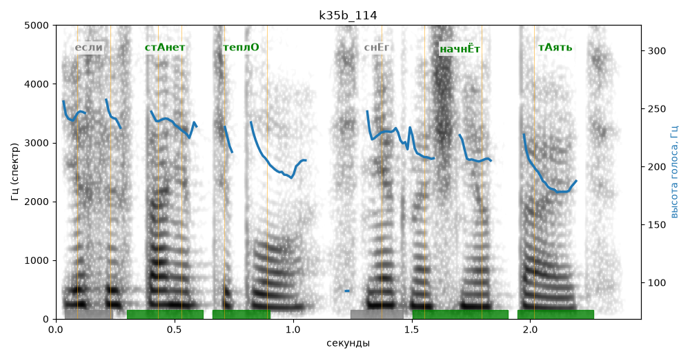

# k35b_114

Голос: **Барсик, сборка 35d** · длительность 2.5 с
Эталон: Если станет тепло, снег начнёт таять.
Распознано: Если станет тепло, снег начнет тает.
Расхождения в словах: «таять» → «тает»

## Ударения
(где нужно: ruaccent)

| слово | нужно | у голоса | |
|---|---|---|---|
| если | если | еслИ | нет эталона |
| станет | стАнет | стАнет | ✓ |
| тепло | теплО | теплО | ✓ |
| начнёт | начнЁт | начнЁт | ✓ |
| таять | тАять | тАять | ✓ |

## Интонация
- ✓ «если станет тепло снег начнёт таять.» — конец фразы понижается — звучит законченно
- Диапазон голоса 5.6 полутонов (нормально), средняя высота 215 Гц

## Паузы и темп
- паузы на своих местах
- Темп 5.3 слога/с (нормально)

_Синяя линия — высота голоса. Над словами заглавная буква — где ударение должно быть; красным — голос поставил не туда (уверенно), оранжевым — возможно._
