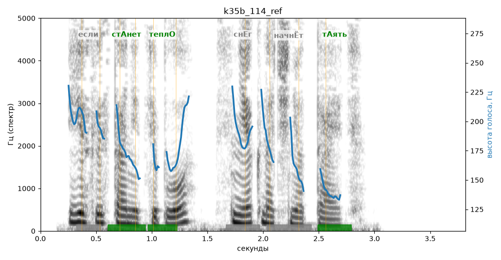

# k35b_114_ref

Голос: **edge:ru-RU-SvetlanaNeural** · длительность 3.8 с
Эталон: Если станет тепло, снег начнёт таять.
Распознано: Если станет тепло, снег начнет таить.
Расхождения в словах: «таять» → «таить»

## Ударения
(где нужно: ruaccent)

| слово | нужно | у голоса | |
|---|---|---|---|
| если | если | Если | нет эталона |
| станет | стАнет | стАнет | ✓ |
| тепло | теплО | теплО | ✓ |
| начнёт | начнЁт | нАчнёт | ? не разобрать |
| таять | тАять | тАять | ✓ |

## Интонация
- ✓ «если станет тепло снег начнёт таять.» — конец фразы понижается — звучит законченно
- Диапазон голоса 7.9 полутонов (живо), средняя высота 177 Гц

## Паузы и темп
- паузы на своих местах
- Темп 4.9 слога/с (нормально)

_Синяя линия — высота голоса. Над словами заглавная буква — где ударение должно быть; красным — голос поставил не туда (уверенно), оранжевым — возможно._
