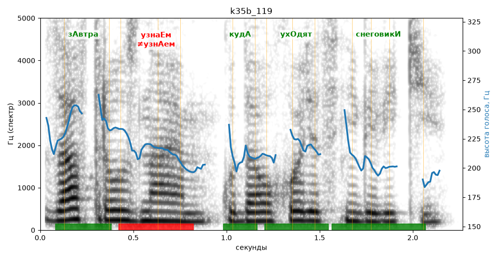

# k35b_119

Голос: **Барсик, сборка 35d** · длительность 2.3 с
Эталон: Завтра узнаем, куда уходят снеговики.
Распознано: Завтра узнаем, куда уходят снеговики.
Слова: все совпали

## Ударения
(где нужно: ruaccent)

| слово | нужно | у голоса | |
|---|---|---|---|
| завтра | зАвтра | зАвтра | ✓ |
| узнаем | узнаЕм | узнАем | ✗ ОШИБКА |
| куда | кудА | кудА | ✓ |
| уходят | ухОдят | ухОдят | ✓ |
| снеговики | снеговикИ | снеговикИ | ✓ |

## Интонация
- ✓ «завтра узнаем куда уходят снеговики.» — конец фразы понижается — звучит законченно
- Диапазон голоса 4.1 полутонов (монотонно, как робот), средняя высота 212 Гц

## Паузы и темп
- паузы на своих местах
- Темп 7.7 слога/с (быстро)

_Синяя линия — высота голоса. Над словами заглавная буква — где ударение должно быть; красным — голос поставил не туда (уверенно), оранжевым — возможно._
