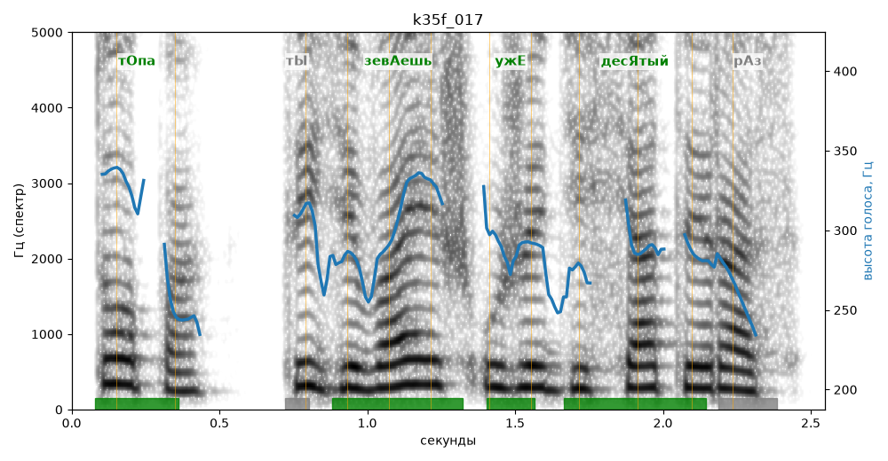

# k35f_017

Голос: **Филя, сборка 35d** · длительность 2.5 с
Эталон: Топа, ты зеваешь уже десятый раз!
Распознано: Топа, ты зеваешь уже 10 раз.
Расхождения в словах: «десятый» → «10»

## Ударения
(где нужно: ruaccent)

| слово | нужно | у голоса | |
|---|---|---|---|
| топа | тОпа | тОпа | ✓ |
| зеваешь | зевАешь | зевАешь | ✓ |
| уже | ужЕ | ужЕ | ✓ |
| десятый | десЯтый | десЯтый | ✓ |

## Интонация
- ✓ «топа ты зеваешь уже десятый раз!» — выделено слово «топа» (+2.6 пт)
- Диапазон голоса 5.5 полутонов (нормально), средняя высота 285 Гц

## Паузы и темп
- паузы на своих местах
- Темп 6.2 слога/с (нормально)

_Синяя линия — высота голоса. Над словами заглавная буква — где ударение должно быть; красным — голос поставил не туда (уверенно), оранжевым — возможно._
