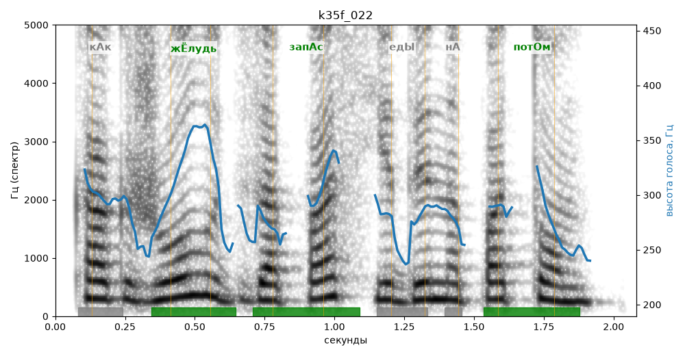

# k35f_022

Голос: **Филя, сборка 35d** · длительность 2.1 с
Эталон: Как жёлудь! Запас еды на потом!
Распознано: Как желуд запас еды на потом?
Расхождения в словах: «желудь» → «желуд»

## Ударения
(где нужно: ruaccent)

| слово | нужно | у голоса | |
|---|---|---|---|
| жёлудь | жЁлудь | жЁлудь | ✓ |
| запас | запАс | запАс | ✓ |
| еды | едЫ | Еды | ? не разобрать |
| потом | потОм | потОм | ✓ |

## Интонация
- ✗ «как жёлудь!» — восклицание звучит ровно, без эмоции
- ✗ «запас еды на потом!» — восклицание звучит ровно, без эмоции
- Диапазон голоса 6.2 полутонов (нормально), средняя высота 286 Гц

## Паузы и темп
- после «жёлудь!» пауза всего 0.06 с — фразы слипаются
- Темп 5.6 слога/с (нормально)

_Синяя линия — высота голоса. Над словами заглавная буква — где ударение должно быть; красным — голос поставил не туда (уверенно), оранжевым — возможно._
