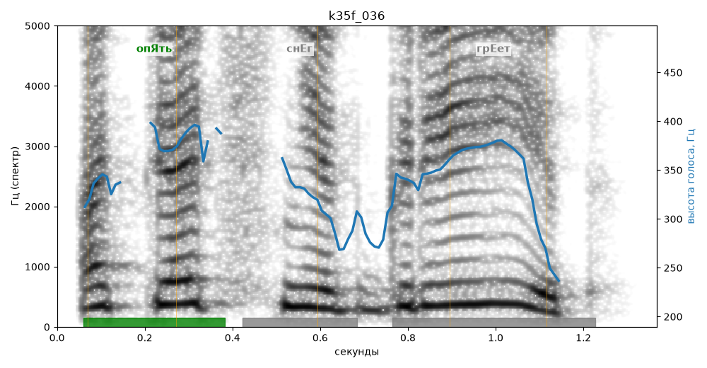

# k35f_036

Голос: **Филя, сборка 35d** · длительность 1.4 с
Эталон: Опять снег греет?
Распознано: Опять снег греет!
Слова: все совпали

## Ударения
(где нужно: ruaccent)

| слово | нужно | у голоса | |
|---|---|---|---|
| опять | опЯть | опЯть | ✓ |
| греет | грЕет | греЕт | ? не разобрать |

## Интонация
- ✗ «опять снег греет?» — нет вопросительного подъёма (самое высокое место — «опять», в начале) — звучит как утверждение
- Диапазон голоса 6.5 полутонов (нормально), средняя высота 343 Гц

## Паузы и темп
- паузы на своих местах
- Темп 4.3 слога/с (нормально)

_Синяя линия — высота голоса. Над словами заглавная буква — где ударение должно быть; красным — голос поставил не туда (уверенно), оранжевым — возможно._
