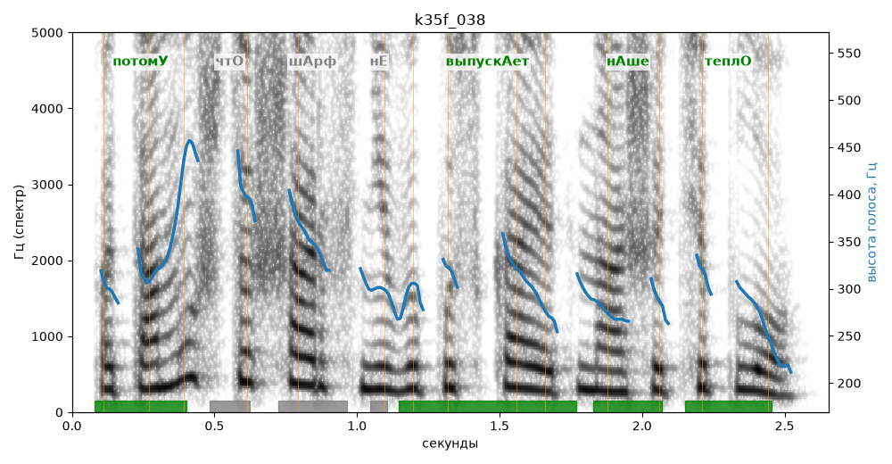

# k35f_038

Голос: **Филя, сборка 35d** · длительность 2.7 с
Эталон: Потому что шарф не выпускает наше тепло?
Распознано: Потому что шарф не выпускает наше тепло.
Слова: все совпали

## Ударения
(где нужно: ruaccent)

| слово | нужно | у голоса | |
|---|---|---|---|
| потому | потомУ | потомУ | ✓ |
| выпускает | выпускАет | выпускАет | ✓ |
| наше | нАше | нАше | ✓ |
| тепло | теплО | теплО | ✓ |

## Интонация
- ✗ «потому что шарф не выпускает наше тепло?» — нет вопросительного подъёма (самое высокое место — «потому», в начале) — звучит как утверждение
- Диапазон голоса 8.9 полутонов (живо), средняя высота 303 Гц

## Паузы и темп
- паузы на своих местах
- Темп 5.9 слога/с (нормально)

_Синяя линия — высота голоса. Над словами заглавная буква — где ударение должно быть; красным — голос поставил не туда (уверенно), оранжевым — возможно._
