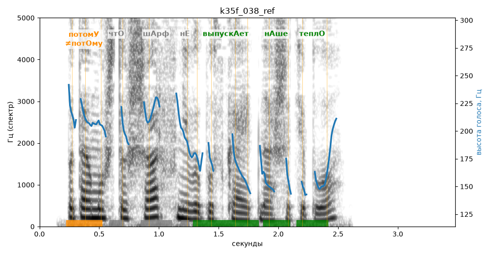

# k35f_038_ref

Голос: **edge:ru-RU-SvetlanaNeural** · длительность 3.5 с
Эталон: Потому что шарф не выпускает наше тепло?
Распознано: Потому что шарф не выпускает наше тепло.
Слова: все совпали

## Ударения
(где нужно: ruaccent)

| слово | нужно | у голоса | |
|---|---|---|---|
| потому | потомУ | потОму | ✗? возможно — послушать |
| выпускает | выпускАет | выпускАет | ✓ |
| наше | нАше | нАше | ✓ |
| тепло | теплО | теплО | ✓ |

## Интонация
- ✓ «потому что шарф не выпускает наше тепло?» — вопросительный подъём на слове «шарф»
- Диапазон голоса 7.5 полутонов (живо), средняя высота 186 Гц

## Паузы и темп
- паузы на своих местах
- Темп 6.4 слога/с (нормально)

_Синяя линия — высота голоса. Над словами заглавная буква — где ударение должно быть; красным — голос поставил не туда (уверенно), оранжевым — возможно._
