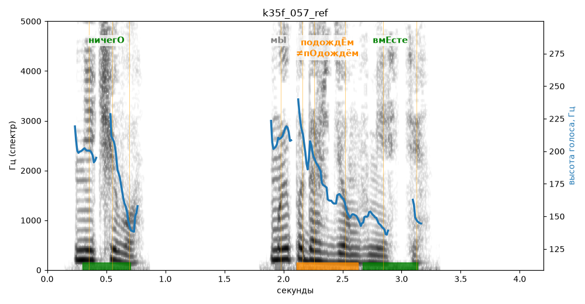

# k35f_057_ref

Голос: **edge:ru-RU-SvetlanaNeural** · длительность 4.2 с
Эталон: Ничего. Мы подождём вместе.
Распознано: Ничего. Мы подождем вместе.
Слова: все совпали

## Ударения
(где нужно: ruaccent)

| слово | нужно | у голоса | |
|---|---|---|---|
| ничего | ничегО | ничегО | ✓ |
| подождём | подождЁм | пОдождём | ✗? возможно — послушать |
| вместе | вмЕсте | вмЕсте | ✓ |

## Интонация
- ✓ «ничего.» — конец фразы понижается — звучит законченно
- ✓ «мы подождём вместе.» — конец фразы понижается — звучит законченно
- Диапазон голоса 7.7 полутонов (живо), средняя высота 168 Гц

## Паузы и темп
- паузы на своих местах
- Темп 5.6 слога/с (нормально)

_Синяя линия — высота голоса. Над словами заглавная буква — где ударение должно быть; красным — голос поставил не туда (уверенно), оранжевым — возможно._
