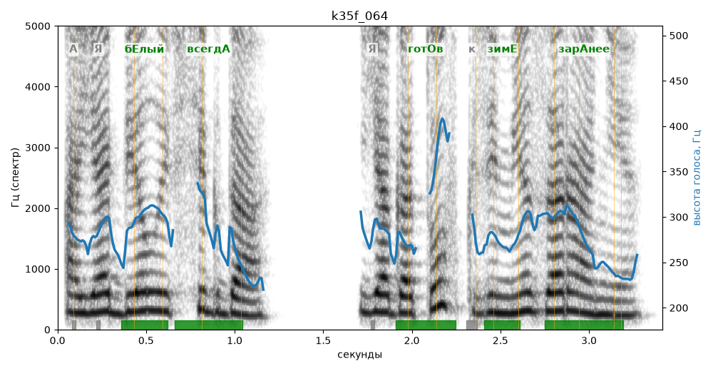

# k35f_064

Голос: **Филя, сборка 35d** · длительность 3.4 с
Эталон: А я белый всегда. Я готов к зиме заранее!
Распознано: А я белый всегда. Я готов к земе заранее.
Расхождения в словах: «зиме» → «земе»

## Ударения
(где нужно: ruaccent)

| слово | нужно | у голоса | |
|---|---|---|---|
| белый | бЕлый | бЕлый | ✓ |
| всегда | всегдА | всегдА | ✓ |
| готов | готОв | готОв | ✓ |
| зиме | зимЕ | зимЕ | ✓ |
| заранее | зарАнее | зарАнее | ✓ |

## Интонация
- ✓ «а я белый всегда.» — конец фразы понижается — звучит законченно
- ✓ «я готов к зиме заранее!» — выделено слово «готов» (+6.1 пт)
- Диапазон голоса 6.1 полутонов (нормально), средняя высота 280 Гц

## Паузы и темп
- паузы на своих местах
- Темп 5.9 слога/с (нормально)

_Синяя линия — высота голоса. Над словами заглавная буква — где ударение должно быть; красным — голос поставил не туда (уверенно), оранжевым — возможно._
