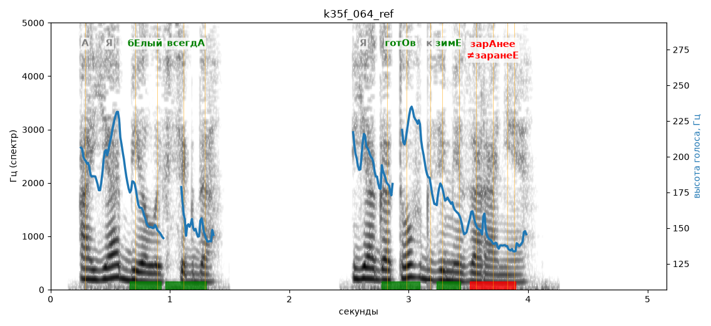

# k35f_064_ref

Голос: **edge:ru-RU-SvetlanaNeural** · длительность 5.2 с
Эталон: А я белый всегда. Я готов к зиме заранее!
Распознано: А я белый всегда. Я готов к зиме заранее.
Слова: все совпали

## Ударения
(где нужно: ruaccent)

| слово | нужно | у голоса | |
|---|---|---|---|
| белый | бЕлый | бЕлый | ✓ |
| всегда | всегдА | всегдА | ✓ |
| готов | готОв | готОв | ✓ |
| зиме | зимЕ | зимЕ | ✓ |
| заранее | зарАнее | заранеЕ | ✗ ОШИБКА |

## Интонация
- ✓ «а я белый всегда.» — конец фразы понижается — звучит законченно
- ✓ «я готов к зиме заранее!» — выделено слово «готов» (+5.9 пт)
- Диапазон голоса 8.5 полутонов (живо), средняя высота 170 Гц

## Паузы и темп
- паузы на своих местах
- Темп 7.1 слога/с (быстро)

_Синяя линия — высота голоса. Над словами заглавная буква — где ударение должно быть; красным — голос поставил не туда (уверенно), оранжевым — возможно._
