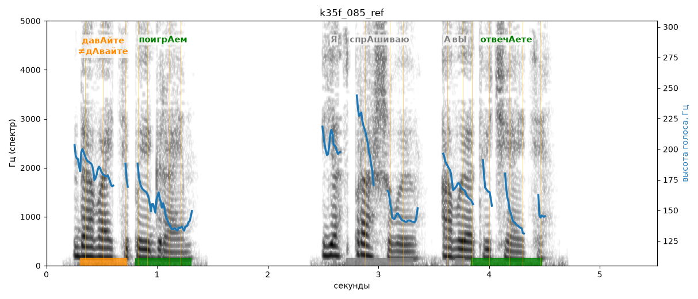

# k35f_085_ref

Голос: **edge:ru-RU-SvetlanaNeural** · длительность 5.5 с
Эталон: Давайте поиграем! Я спрашиваю, а вы отвечаете.
Распознано: Давайте поиграем. Я спрашиваю, а вы отвечаете.
Слова: все совпали

## Ударения
(где нужно: ruaccent)

| слово | нужно | у голоса | |
|---|---|---|---|
| давайте | давАйте | дАвайте | ✗? возможно — послушать |
| поиграем | поигрАем | поигрАем | ✓ |
| спрашиваю | спрАшиваю | — | ? |
| отвечаете | отвечАете | отвечАете | ✓ |

## Интонация
- ✗ «давайте поиграем!» — восклицание звучит ровно, без эмоции
- ✓ «я спрашиваю а вы отвечаете.» — конец фразы понижается — звучит законченно
- Диапазон голоса 7.9 полутонов (живо), средняя высота 166 Гц

## Паузы и темп
- паузы на своих местах
- Темп 6.6 слога/с (быстро)

_Синяя линия — высота голоса. Над словами заглавная буква — где ударение должно быть; красным — голос поставил не туда (уверенно), оранжевым — возможно._
