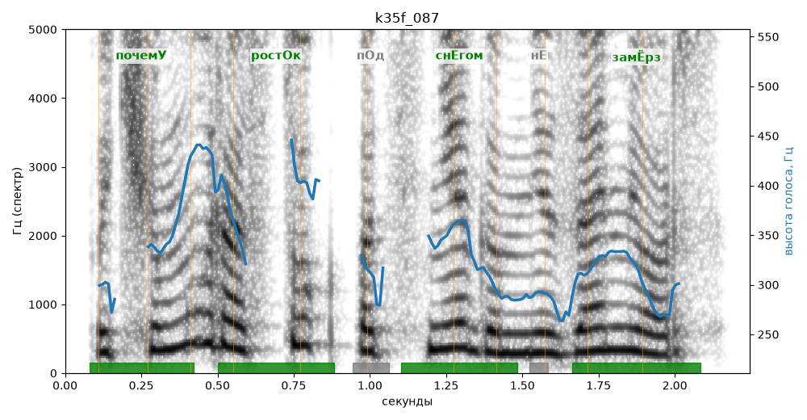

# k35f_087

Голос: **Филя, сборка 35d** · длительность 2.2 с
Эталон: Почему росток под снегом не замёрз?
Распознано: Почему росток под снегом не замерз?
Слова: все совпали

## Ударения
(где нужно: ruaccent)

| слово | нужно | у голоса | |
|---|---|---|---|
| почему | почемУ | почемУ | ✓ |
| росток | ростОк | ростОк | ✓ |
| снегом | снЕгом | снЕгом | ✓ |
| замёрз | замЁрз | замЁрз | ✓ |

## Интонация
- ✓ «почему росток под снегом не замёрз?» — конец фразы понижается — звучит законченно
- Диапазон голоса 8.1 полутонов (живо), средняя высота 324 Гц

## Паузы и темп
- паузы на своих местах
- Темп 5.5 слога/с (нормально)

_Синяя линия — высота голоса. Над словами заглавная буква — где ударение должно быть; красным — голос поставил не туда (уверенно), оранжевым — возможно._
