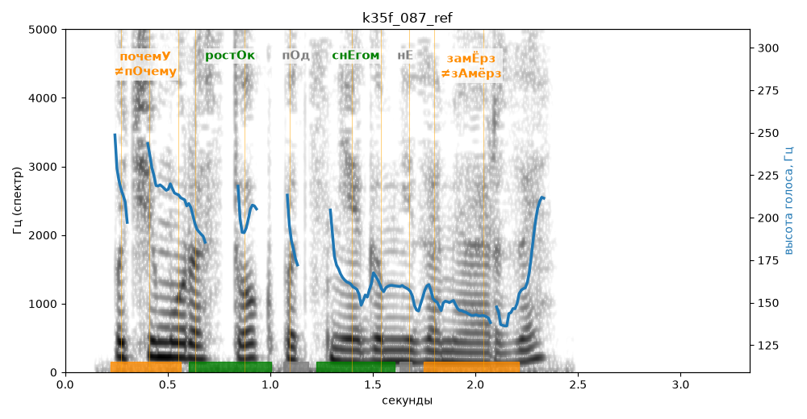

# k35f_087_ref

Голос: **edge:ru-RU-SvetlanaNeural** · длительность 3.3 с
Эталон: Почему росток под снегом не замё́рз?
Распознано: Почему росток под снегом не замерзы?
Расхождения в словах: «заме рз» → «замерзы»

## Ударения
(где нужно: ruaccent)

| слово | нужно | у голоса | |
|---|---|---|---|
| почему | почемУ | пОчему | ✗? возможно — послушать |
| росток | ростОк | ростОк | ✓ |
| снегом | снЕгом | снЕгом | ✓ |
| замёрз | замЁрз | зАмёрз | ✗? возможно — послушать |

## Интонация
- ✓ «почему росток под снегом не замёрз?» — конец фразы понижается — звучит законченно
- Диапазон голоса 7.5 полутонов (живо), средняя высота 161 Гц

## Паузы и темп
- паузы на своих местах
- Темп 5.5 слога/с (нормально)

_Синяя линия — высота голоса. Над словами заглавная буква — где ударение должно быть; красным — голос поставил не туда (уверенно), оранжевым — возможно._
