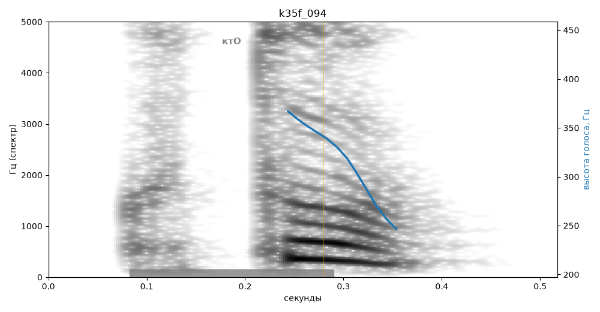

# k35f_094

Голос: **Филя, сборка 35d** · длительность 0.5 с
Эталон: Кто?
Распознано: Охоже с
Расхождения в словах: «кто» → «охоже с»

## Ударения
(где нужно: дано в тексте)

| слово | нужно | у голоса | |
|---|---|---|---|

## Интонация
- Диапазон голоса 6.3 полутонов (нормально), средняя высота 324 Гц

## Паузы и темп
- паузы на своих местах
- Темп 4.8 слога/с (нормально)

_Синяя линия — высота голоса. Над словами заглавная буква — где ударение должно быть; красным — голос поставил не туда (уверенно), оранжевым — возможно._
