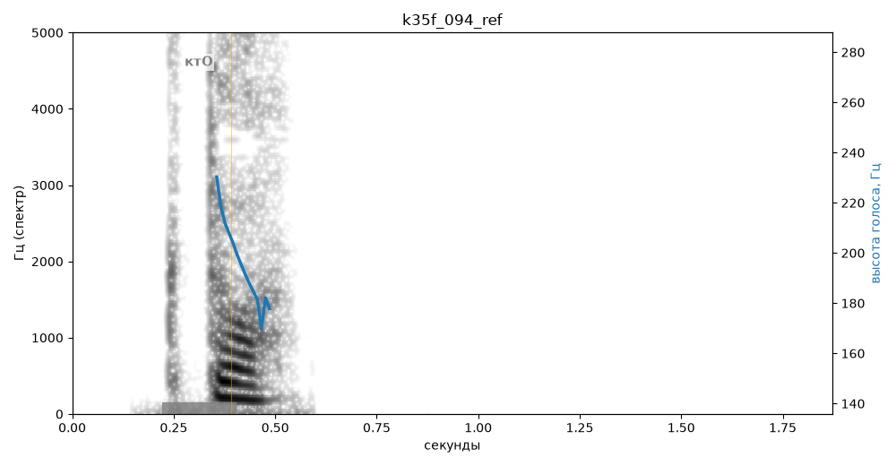

# k35f_094_ref

Голос: **edge:ru-RU-SvetlanaNeural** · длительность 1.9 с
Эталон: Кто?
Распознано: Кто?
Слова: все совпали

## Ударения
(где нужно: дано в тексте)

| слово | нужно | у голоса | |
|---|---|---|---|

## Интонация
- Диапазон голоса 4.2 полутонов (монотонно, как робот), средняя высота 193 Гц

## Паузы и темп
- паузы на своих местах
- Темп 5.5 слога/с (нормально)

_Синяя линия — высота голоса. Над словами заглавная буква — где ударение должно быть; красным — голос поставил не туда (уверенно), оранжевым — возможно._
