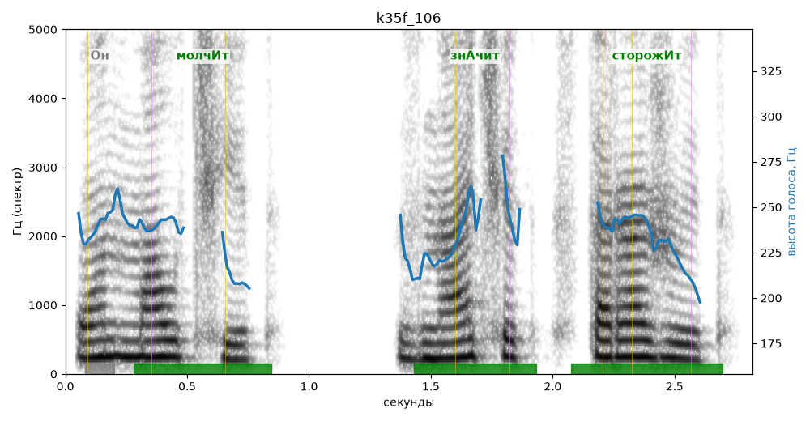

# k35f_106

Голос: **Филя, сборка 35d** · длительность 2.8 с
Эталон: Он молчит. Значит, сторожит.
Распознано: Он молчит, значит, старожит.
Расхождения в словах: «сторожит» → «старожит»

## Ударения
(где нужно: ruaccent)

| слово | нужно | у голоса | |
|---|---|---|---|
| молчит | молчИт | молчИт | ✓ |
| значит | знАчит | знАчит | ✓ |
| сторожит | сторожИт | сторожИт | ✓ |

## Интонация
- ✓ «он молчит.» — конец фразы понижается — звучит законченно
- ✓ «значит сторожит.» — конец фразы понижается — звучит законченно
- Диапазон голоса 3.5 полутонов (монотонно, как робот), средняя высота 237 Гц

## Паузы и темп
- паузы на своих местах
- Темп 3.9 слога/с (медленно)

_Синяя линия — высота голоса. Над словами заглавная буква — где ударение должно быть; красным — голос поставил не туда (уверенно), оранжевым — возможно._
