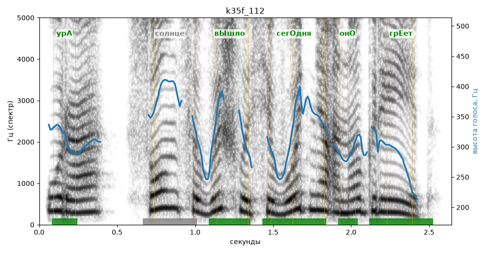

# k35f_112

Голос: **Филя, сборка 35d** · длительность 2.6 с
Эталон: Ура, солнце вышло! Сегодня оно греет.
Распознано: Ура, солнце вышло сегодня, оно греет.
Слова: все совпали

## Ударения
(где нужно: ruaccent)

| слово | нужно | у голоса | |
|---|---|---|---|
| ура | урА | урА | ✓ |
| солнце | солнце | сОлнце | нет эталона |
| вышло | вЫшло | вЫшло | ✓ |
| сегодня | сегОдня | сегОдня | ✓ |
| оно | онО | онО | ✓ |
| греет | грЕет | грЕет | ✓ |

## Интонация
- ✓ «ура солнце вышло!» — выделено слово «солнце» (+3.3 пт)
- ✗ «сегодня оно греет.» — конец фразы не понижается — звучит незаконченно / как перечисление
- Диапазон голоса 8.5 полутонов (живо), средняя высота 309 Гц

## Паузы и темп
- после «вышло!» пауза всего 0.08 с — фразы слипаются
- Темп 6.4 слога/с (нормально)

_Синяя линия — высота голоса. Над словами заглавная буква — где ударение должно быть; красным — голос поставил не туда (уверенно), оранжевым — возможно._
