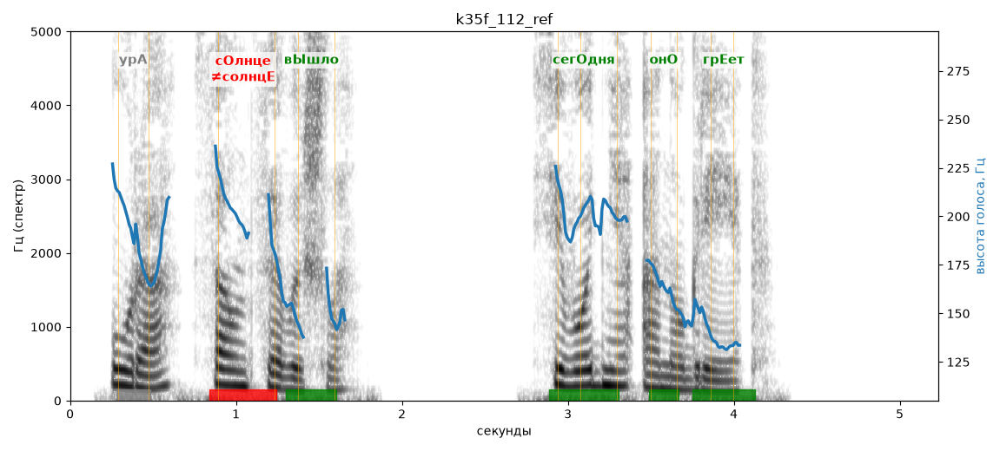

# k35f_112_ref

Голос: **edge:ru-RU-SvetlanaNeural** · длительность 5.2 с
Эталон: Ура, со́лнце вышло! Сегодня оно́ гре́ет.
Распознано: Ура, Солнце вышло. Сегодня оно греет.
Расхождения в словах: «со лнце» → «солнце»; «гре ет» → «греет»

## Ударения
(где нужно: ruaccent)

| слово | нужно | у голоса | |
|---|---|---|---|
| ура | урА | Ура | ? не разобрать |
| солнце | сОлнце | солнцЕ | ✗ ОШИБКА |
| вышло | вЫшло | вЫшло | ✓ |
| сегодня | сегОдня | сегОдня | ✓ |
| оно | онО | онО | ✓ |
| греет | грЕет | грЕет | ✓ |

## Интонация
- ✓ «ура солнце вышло!» — выделено слово «солнце» (+2.8 пт)
- ✓ «сегодня оно греет.» — конец фразы понижается — звучит законченно
- Диапазон голоса 8.3 полутонов (живо), средняя высота 177 Гц

## Паузы и темп
- паузы на своих местах
- Темп 6.4 слога/с (нормально)

_Синяя линия — высота голоса. Над словами заглавная буква — где ударение должно быть; красным — голос поставил не туда (уверенно), оранжевым — возможно._
