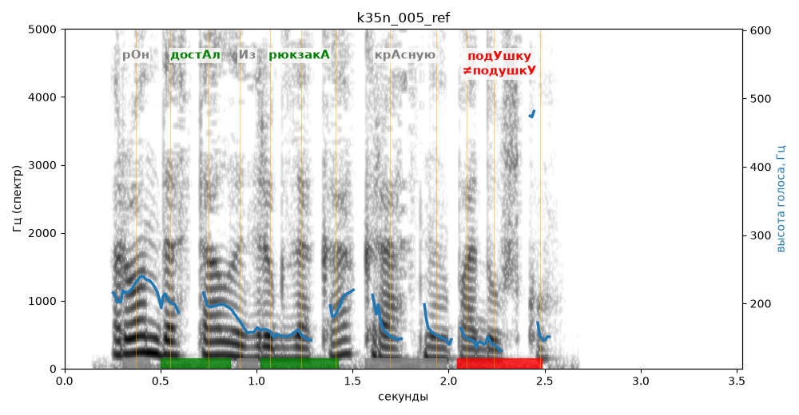

# k35n_005_ref

Голос: **edge:ru-RU-SvetlanaNeural** · длительность 3.5 с
Эталон: Рон достал из рюкзака красную подушку.
Распознано: Рон достал из рюкзака красную подушку.
Слова: все совпали

## Ударения
(где нужно: ruaccent)

| слово | нужно | у голоса | |
|---|---|---|---|
| достал | достАл | достАл | ✓ |
| рюкзака | рюкзакА | рюкзакА | ✓ |
| красную | крАсную | — | ? |
| подушку | подУшку | подушкУ | ✗ ОШИБКА |

## Интонация
- ✓ «рон достал из рюкзака красную подушку.» — конец фразы понижается — звучит законченно
- Диапазон голоса 8.7 полутонов (живо), средняя высота 164 Гц

## Паузы и темп
- паузы на своих местах
- Темп 5.5 слога/с (нормально)

_Синяя линия — высота голоса. Над словами заглавная буква — где ударение должно быть; красным — голос поставил не туда (уверенно), оранжевым — возможно._
