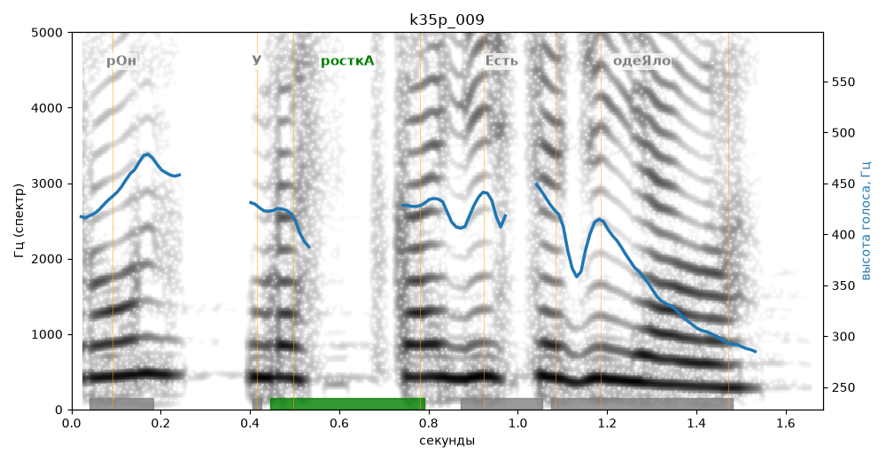

# k35p_009

Голос: **Пик, сборка 35d** · длительность 1.7 с
Эталон: Рон, у ростка есть одеяло.
Распознано: Рун, ростка и сидела.
Расхождения в словах: «рон у» → «рун»; «есть одеяло» → «и сидела»

## Ударения
(где нужно: ruaccent)

| слово | нужно | у голоса | |
|---|---|---|---|
| ростка | росткА | росткА | ✓ |
| одеяло | одеЯло | — | ? |

## Интонация
- ✓ «рон у ростка есть одеяло.» — конец фразы понижается — звучит законченно
- Диапазон голоса 8.0 полутонов (живо), средняя высота 417 Гц

## Паузы и темп
- паузы на своих местах
- Темп 6.6 слога/с (быстро)

_Синяя линия — высота голоса. Над словами заглавная буква — где ударение должно быть; красным — голос поставил не туда (уверенно), оранжевым — возможно._
