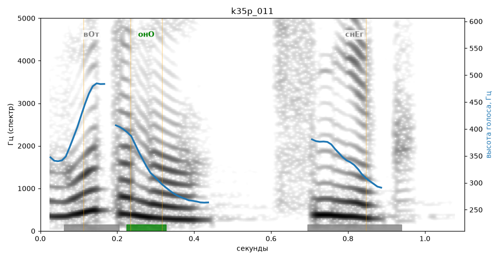

# k35p_011

Голос: **Пик, сборка 35d** · длительность 1.1 с
Эталон: Вот оно. Снег!
Распознано: Вот оно, снег.
Слова: все совпали

## Ударения
(где нужно: ruaccent)

| слово | нужно | у голоса | |
|---|---|---|---|
| оно | онО | онО | ✓ |

## Интонация
- ✓ «вот оно.» — конец фразы понижается — звучит законченно
- Диапазон голоса 10.3 полутонов (живо), средняя высота 342 Гц

## Паузы и темп
- паузы на своих местах
- Темп 7.8 слога/с (быстро)

_Синяя линия — высота голоса. Над словами заглавная буква — где ударение должно быть; красным — голос поставил не туда (уверенно), оранжевым — возможно._
