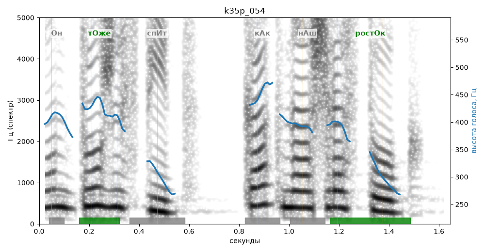

# k35p_054

Голос: **Пик, сборка 35d** · длительность 1.6 с
Эталон: Он тоже спит. Как наш росток.
Распознано: Он тоже спит, как наш росток.
Слова: все совпали

## Ударения
(где нужно: ruaccent)

| слово | нужно | у голоса | |
|---|---|---|---|
| тоже | тОже | тОже | ✓ |
| росток | ростОк | ростОк | ✓ |

## Интонация
- ✓ «он тоже спит.» — конец фразы понижается — звучит законченно
- ✓ «как наш росток.» — конец фразы понижается — звучит законченно
- Диапазон голоса 8.9 полутонов (живо), средняя высота 397 Гц

## Паузы и темп
- паузы на своих местах
- Темп 6.6 слога/с (быстро)

_Синяя линия — высота голоса. Над словами заглавная буква — где ударение должно быть; красным — голос поставил не туда (уверенно), оранжевым — возможно._
