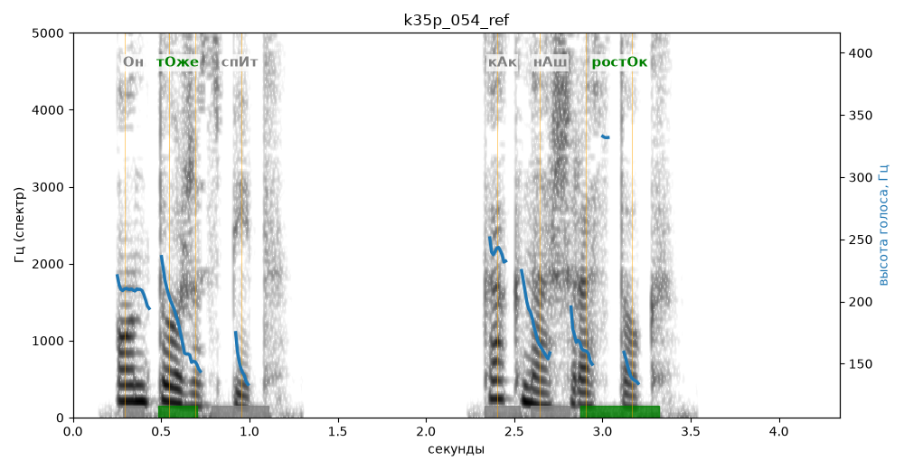

# k35p_054_ref

Голос: **edge:ru-RU-SvetlanaNeural** · длительность 4.3 с
Эталон: Он тоже спит. Как наш росток.
Распознано: Он тоже спит. Как наш расток?
Расхождения в словах: «росток» → «расток»

## Ударения
(где нужно: ruaccent)

| слово | нужно | у голоса | |
|---|---|---|---|
| тоже | тОже | тОже | ✓ |
| росток | ростОк | ростОк | ✓ |

## Интонация
- ✓ «он тоже спит.» — конец фразы понижается — звучит законченно
- ✓ «как наш росток.» — конец фразы понижается — звучит законченно
- Диапазон голоса 9.9 полутонов (живо), средняя высота 180 Гц

## Паузы и темп
- паузы на своих местах
- Темп 4.4 слога/с (нормально)

_Синяя линия — высота голоса. Над словами заглавная буква — где ударение должно быть; красным — голос поставил не туда (уверенно), оранжевым — возможно._
