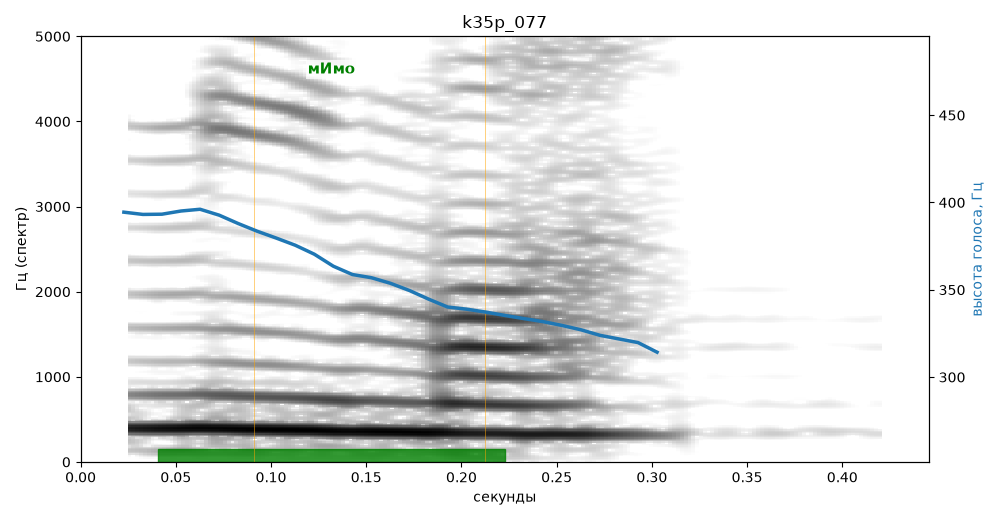

# k35p_077

Голос: **Пик, сборка 35d** · длительность 0.4 с
Эталон: Мимо!
Распознано: Мимо!
Слова: все совпали

## Ударения
(где нужно: ruaccent)

| слово | нужно | у голоса | |
|---|---|---|---|
| мимо | мИмо | мИмо | ✓ |

## Интонация
- Диапазон голоса 3.6 полутонов (монотонно, как робот), средняя высота 354 Гц

## Паузы и темп
- паузы на своих местах
- Темп 11.0 слога/с (быстро)

_Синяя линия — высота голоса. Над словами заглавная буква — где ударение должно быть; красным — голос поставил не туда (уверенно), оранжевым — возможно._
