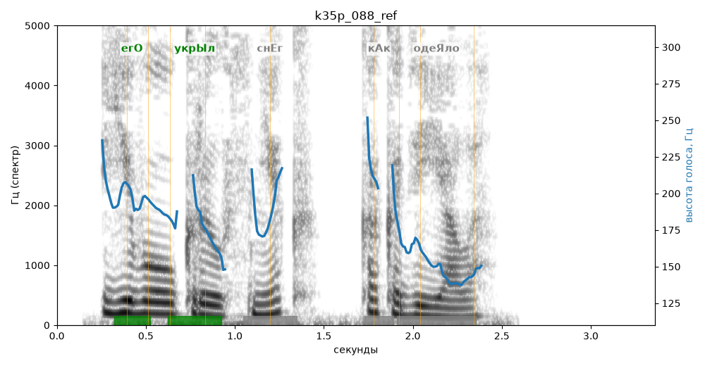

# k35p_088_ref

Голос: **edge:ru-RU-SvetlanaNeural** · длительность 3.4 с
Эталон: Его укрыл снег, как одеяло.
Распознано: Его укрыл снег, как одиала.
Расхождения в словах: «одеяло» → «одиала»

## Ударения
(где нужно: ruaccent)

| слово | нужно | у голоса | |
|---|---|---|---|
| его | егО | егО | ✓ |
| укрыл | укрЫл | укрЫл | ✓ |
| одеяло | одеЯло | — | ? |

## Интонация
- ✓ «его укрыл снег как одеяло.» — конец фразы понижается — звучит законченно
- Диапазон голоса 7.7 полутонов (живо), средняя высота 179 Гц

## Паузы и темп
- паузы на своих местах
- Темп 5.5 слога/с (нормально)

_Синяя линия — высота голоса. Над словами заглавная буква — где ударение должно быть; красным — голос поставил не туда (уверенно), оранжевым — возможно._
