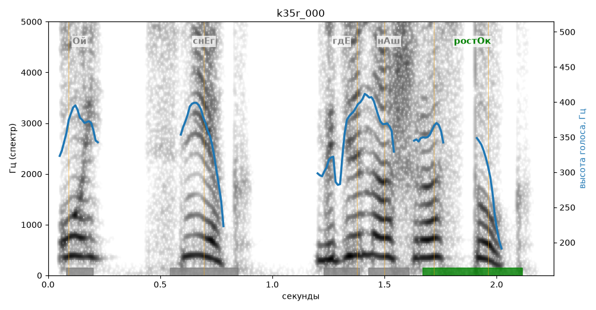

# k35r_000

Голос: **Рон, сборка 35d** · длительность 2.3 с
Эталон: Ой! Снег! Где наш росток?
Распознано: Ой, снег! Где наш расток?
Расхождения в словах: «росток» → «расток»

## Ударения
(где нужно: ruaccent)

| слово | нужно | у голоса | |
|---|---|---|---|
| росток | ростОк | ростОк | ✓ |

## Интонация
- ✓ «где наш росток?» — конец фразы понижается — звучит законченно
- Диапазон голоса 7.8 полутонов (живо), средняя высота 359 Гц

## Паузы и темп
- паузы на своих местах
- Темп 4.6 слога/с (нормально)

_Синяя линия — высота голоса. Над словами заглавная буква — где ударение должно быть; красным — голос поставил не туда (уверенно), оранжевым — возможно._
