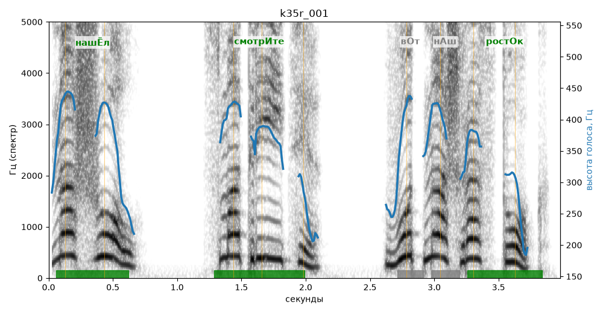

# k35r_001

Голос: **Рон, сборка 35d** · длительность 4.0 с
Эталон: Нашёл! Смотрите! Вот наш росток!
Распознано: Нашел! Смотрите! Вот наш расток!
Расхождения в словах: «росток» → «расток»

## Ударения
(где нужно: ruaccent)

| слово | нужно | у голоса | |
|---|---|---|---|
| нашёл | нашЁл | нашЁл | ✓ |
| смотрите | смотрИте | смотрИте | ✓ |
| росток | ростОк | ростОк | ✓ |

## Интонация
- ✗ «смотрите!» — восклицание звучит ровно, без эмоции
- ✗ «вот наш росток!» — восклицание звучит ровно, без эмоции
- Диапазон голоса 12.0 полутонов (живо), средняя высота 372 Гц

## Паузы и темп
- паузы на своих местах
- Темп 3.8 слога/с (медленно)

_Синяя линия — высота голоса. Над словами заглавная буква — где ударение должно быть; красным — голос поставил не туда (уверенно), оранжевым — возможно._
