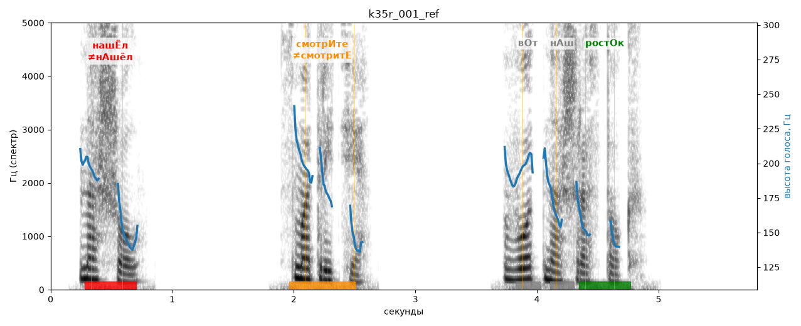

# k35r_001_ref

Голос: **edge:ru-RU-SvetlanaNeural** · длительность 5.8 с
Эталон: Нашёл! Смотри́те! Вот наш росток!
Распознано: нашел. смотрите, вот наш росток
Расхождения в словах: «смотри те» → «смотрите»

## Ударения
(где нужно: ruaccent)

| слово | нужно | у голоса | |
|---|---|---|---|
| нашёл | нашЁл | нАшёл | ✗ ОШИБКА |
| смотрите | смотрИте | смотритЕ | ✗? возможно — послушать |
| росток | ростОк | ростОк | ✓ |

## Интонация
- ✗ «смотрите!» — восклицание звучит ровно, без эмоции
- ✓ «вот наш росток!» — выделено слово «вот» (+3.0 пт)
- Диапазон голоса 7.1 полутонов (живо), средняя высота 184 Гц

## Паузы и темп
- паузы на своих местах
- Темп 4.7 слога/с (нормально)

_Синяя линия — высота голоса. Над словами заглавная буква — где ударение должно быть; красным — голос поставил не туда (уверенно), оранжевым — возможно._
