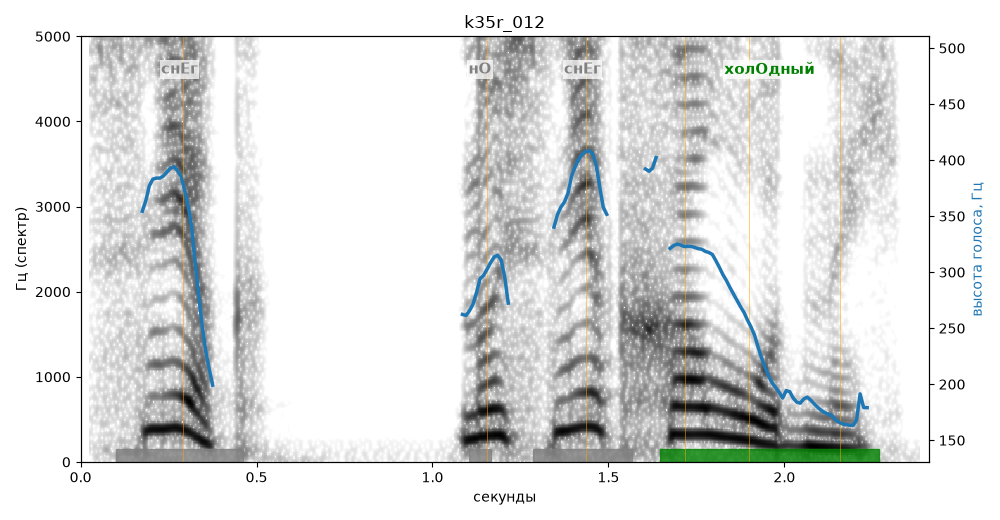

# k35r_012

Голос: **Рон, сборка 35d** · длительность 2.4 с
Эталон: Снег? Но снег холодный!
Распознано: Сник! Но снег холодный!
Расхождения в словах: «снег» → «сник»

## Ударения
(где нужно: ruaccent)

| слово | нужно | у голоса | |
|---|---|---|---|
| холодный | холОдный | холОдный | ✓ |

## Интонация
- ✓ «но снег холодный!» — выделено слово «снег» (+4.4 пт)
- Диапазон голоса 14.9 полутонов (живо), средняя высота 300 Гц

## Паузы и темп
- паузы на своих местах
- Темп 3.9 слога/с (медленно)

_Синяя линия — высота голоса. Над словами заглавная буква — где ударение должно быть; красным — голос поставил не туда (уверенно), оранжевым — возможно._
