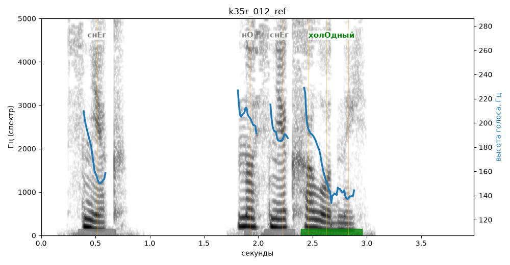

# k35r_012_ref

Голос: **edge:ru-RU-SvetlanaNeural** · длительность 4.0 с
Эталон: Снег? Но снег холодный!
Распознано: снег. Но снег холодный.
Слова: все совпали

## Ударения
(где нужно: ruaccent)

| слово | нужно | у голоса | |
|---|---|---|---|
| холодный | холОдный | холОдный | ✓ |

## Интонация
- ✗ «но снег холодный!» — восклицание звучит ровно, без эмоции
- Диапазон голоса 7.3 полутонов (живо), средняя высота 185 Гц

## Паузы и темп
- паузы на своих местах
- Темп 4.2 слога/с (нормально)

_Синяя линия — высота голоса. Над словами заглавная буква — где ударение должно быть; красным — голос поставил не туда (уверенно), оранжевым — возможно._
