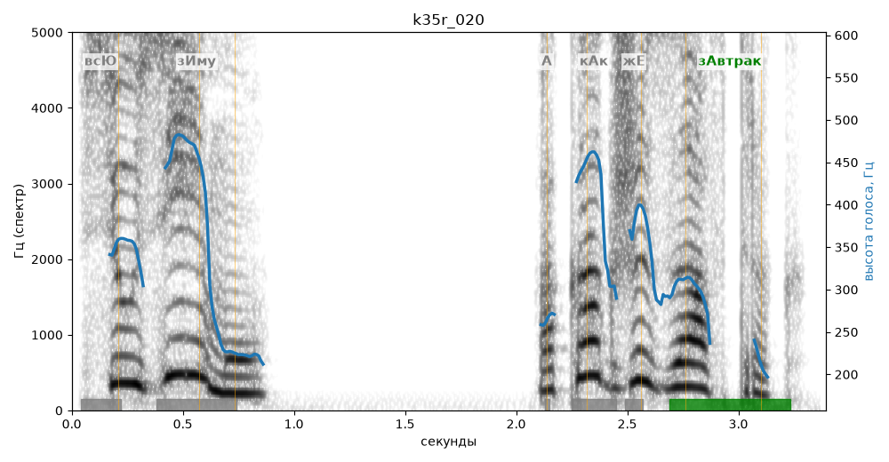

# k35r_020

Голос: **Рон, сборка 35d** · длительность 3.4 с
Эталон: Всю зиму? А как же завтрак?
Распознано: Все зиму! А как же завтрак?
Расхождения в словах: «всю» → «все»

## Ударения
(где нужно: ruaccent)

| слово | нужно | у голоса | |
|---|---|---|---|
| зиму | зИму | зимУ | ? не разобрать |
| завтрак | зАвтрак | зАвтрак | ✓ |

## Интонация
- ✓ «всю зиму?» — вопросительный подъём на слове «зиму»
- ✓ «а как же завтрак?» — вопросительный подъём на слове «как»
- Диапазон голоса 13.2 полутонов (живо), средняя высота 312 Гц

## Паузы и темп
- паузы на своих местах
- Темп 4.9 слога/с (нормально)

_Синяя линия — высота голоса. Над словами заглавная буква — где ударение должно быть; красным — голос поставил не туда (уверенно), оранжевым — возможно._
