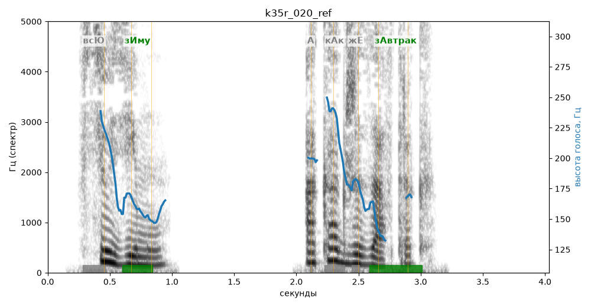

# k35r_020_ref

Голос: **edge:ru-RU-SvetlanaNeural** · длительность 4.0 с
Эталон: Всю зи́му? А как же завтрак?
Распознано: всю зиму. А как же завтрак?
Расхождения в словах: «зи му» → «зиму»

## Ударения
(где нужно: ruaccent)

| слово | нужно | у голоса | |
|---|---|---|---|
| зиму | зИму | зИму | ✓ |
| завтрак | зАвтрак | зАвтрак | ✓ |

## Интонация
- ✓ «всю зиму?» — вопросительный подъём на слове «всю»
- ✓ «а как же завтрак?» — вопросительный подъём на слове «как»
- Диапазон голоса 9.2 полутонов (живо), средняя высота 168 Гц

## Паузы и темп
- паузы на своих местах
- Темп 5.5 слога/с (нормально)

_Синяя линия — высота голоса. Над словами заглавная буква — где ударение должно быть; красным — голос поставил не туда (уверенно), оранжевым — возможно._
