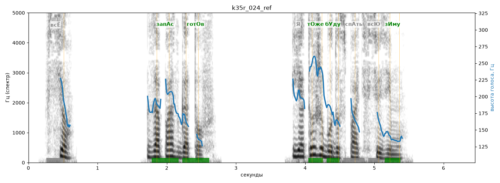

# k35r_024_ref

Голос: **edge:ru-RU-SvetlanaNeural** · длительность 6.5 с
Эталон: Всё! Запас готов. Я тоже буду спать всю зи́му!
Распознано: Все. Запас готов. Я тоже буду спать всю зиму.
Расхождения в словах: «зи му» → «зиму»

## Ударения
(где нужно: ruaccent)

| слово | нужно | у голоса | |
|---|---|---|---|
| запас | запАс | запАс | ✓ |
| готов | готОв | готОв | ✓ |
| тоже | тОже | тОже | ✓ |
| буду | бУду | бУду | ✓ |
| зиму | зИму | зИму | ✓ |

## Интонация
- ✓ «запас готов.» — конец фразы понижается — звучит законченно
- ✓ «я тоже буду спать всю зиму!» — выделено слово «тоже» (+7.3 пт)
- Диапазон голоса 10.4 полутонов (живо), средняя высота 176 Гц

## Паузы и темп
- паузы на своих местах
- Темп 5.1 слога/с (нормально)

_Синяя линия — высота голоса. Над словами заглавная буква — где ударение должно быть; красным — голос поставил не туда (уверенно), оранжевым — возможно._
