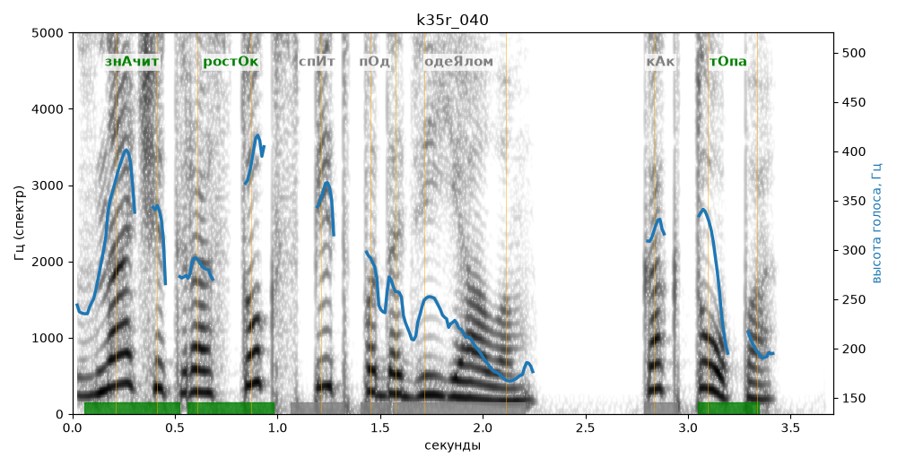

# k35r_040

Голос: **Рон, сборка 35d** · длительность 3.7 с
Эталон: Значит, росток спит под одеялом. Как Топа!
Распознано: Значит, росток спит под одеялом. Как топа?
Слова: все совпали

## Ударения
(где нужно: ruaccent)

| слово | нужно | у голоса | |
|---|---|---|---|
| значит | знАчит | знАчит | ✓ |
| росток | ростОк | ростОк | ✓ |
| одеялом | одеЯлом | — | ? |
| топа | тОпа | тОпа | ✓ |

## Интонация
- ✓ «значит росток спит под одеялом.» — конец фразы понижается — звучит законченно
- ✗ «как топа!» — восклицание звучит ровно, без эмоции
- Диапазон голоса 14.1 полутонов (живо), средняя высота 257 Гц

## Паузы и темп
- после «значит,» нет паузы (0.04 с)
- Темп 4.4 слога/с (нормально)

_Синяя линия — высота голоса. Над словами заглавная буква — где ударение должно быть; красным — голос поставил не туда (уверенно), оранжевым — возможно._
