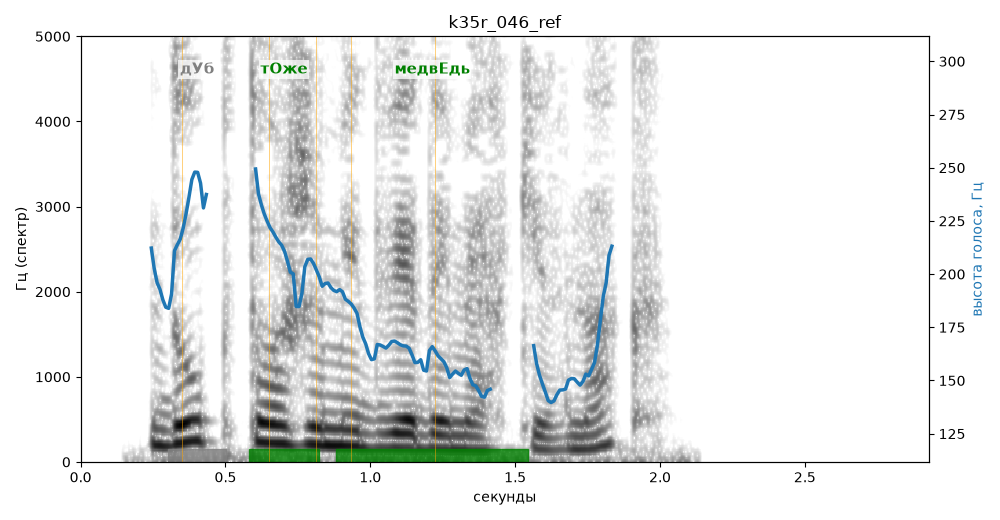

# k35r_046_ref

Голос: **edge:ru-RU-SvetlanaNeural** · длительность 2.9 с
Эталон: Дуб тоже медве́дь?
Распознано: Дуб тоже медведомеркий знак.
Расхождения в словах: «медве дь» → «медведомеркий знак»

## Ударения
(где нужно: ruaccent)

| слово | нужно | у голоса | |
|---|---|---|---|
| тоже | тОже | тОже | ✓ |
| медведь | медвЕдь | медвЕдь | ✓ |

## Интонация
- ✗ «дуб тоже медведь?» — нет вопросительного подъёма (самое высокое место — «дуб», в начале) — звучит как утверждение
- Диапазон голоса 8.5 полутонов (живо), средняя высота 168 Гц

## Паузы и темп
- паузы на своих местах
- Темп 4.0 слога/с (нормально)

_Синяя линия — высота голоса. Над словами заглавная буква — где ударение должно быть; красным — голос поставил не туда (уверенно), оранжевым — возможно._
