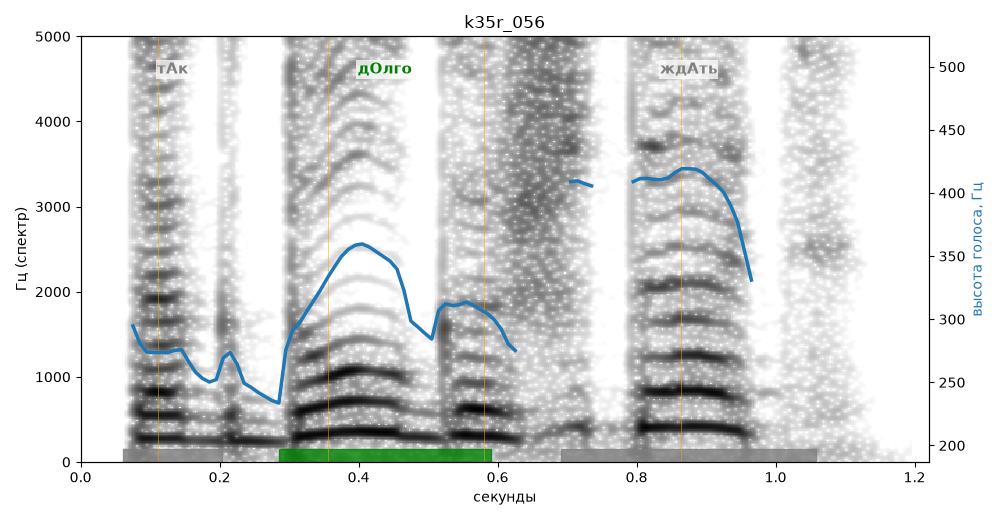

# k35r_056

Голос: **Рон, сборка 35d** · длительность 1.2 с
Эталон: Так долго ждать?
Распознано: Так долго ждать?
Слова: все совпали

## Ударения
(где нужно: ruaccent)

| слово | нужно | у голоса | |
|---|---|---|---|
| долго | дОлго | дОлго | ✓ |

## Интонация
- ✓ «так долго ждать?» — вопросительный подъём на слове «ждать»
- Диапазон голоса 9.1 полутонов (живо), средняя высота 311 Гц

## Паузы и темп
- паузы на своих местах
- Темп 4.0 слога/с (нормально)

_Синяя линия — высота голоса. Над словами заглавная буква — где ударение должно быть; красным — голос поставил не туда (уверенно), оранжевым — возможно._
