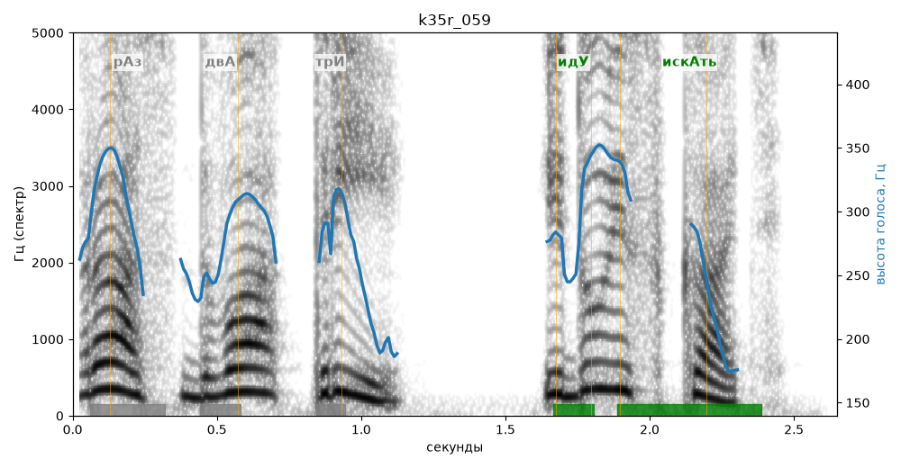

# k35r_059

Голос: **Рон, сборка 35d** · длительность 2.6 с
Эталон: Раз, два, три! Иду искать!
Распознано: Раз, два, три! Иду искать!
Слова: все совпали

## Ударения
(где нужно: ruaccent)

| слово | нужно | у голоса | |
|---|---|---|---|
| иду | идУ | идУ | ✓ |
| искать | искАть | искАть | ✓ |

## Интонация
- ✗ «раз два три!» — восклицание звучит ровно, без эмоции
- ✓ «иду искать!» — выделено слово «иду» (+2.0 пт)
- Диапазон голоса 10.6 полутонов (живо), средняя высота 280 Гц

## Паузы и темп
- паузы на своих местах
- Темп 5.2 слога/с (нормально)

_Синяя линия — высота голоса. Над словами заглавная буква — где ударение должно быть; красным — голос поставил не туда (уверенно), оранжевым — возможно._
