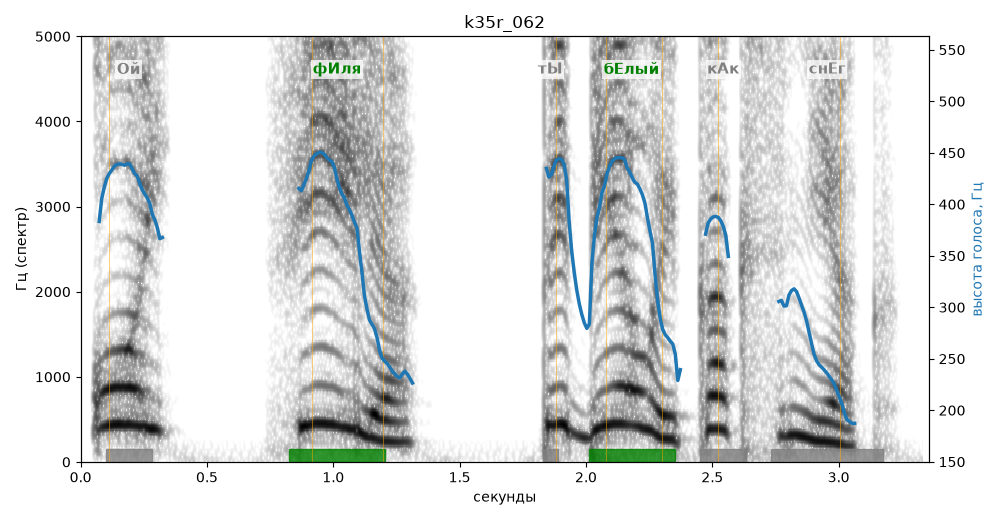

# k35r_062

Голос: **Рон, сборка 35d** · длительность 3.4 с
Эталон: Ой! Филя! Ты белый, как снег!
Распознано: Ой, Фили, ты белый как снег!
Расхождения в словах: «филя» → «фили»

## Ударения
(где нужно: ruaccent)

| слово | нужно | у голоса | |
|---|---|---|---|
| филя | фИля | фИля | ✓ |
| белый | бЕлый | бЕлый | ✓ |

## Интонация
- ✗ «ты белый как снег!» — восклицание звучит ровно, без эмоции
- Диапазон голоса 11.8 полутонов (живо), средняя высота 379 Гц

## Паузы и темп
- паузы на своих местах
- Темп 4.2 слога/с (нормально)

_Синяя линия — высота голоса. Над словами заглавная буква — где ударение должно быть; красным — голос поставил не туда (уверенно), оранжевым — возможно._
