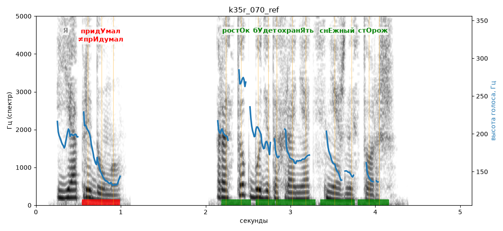

# k35r_070_ref

Голос: **edge:ru-RU-SvetlanaNeural** · длительность 5.1 с
Эталон: Я придумал! Росток будет охранять снежный сторож!
Распознано: Я придумал. Росток будет охранять снежный сторож.
Слова: все совпали

## Ударения
(где нужно: ruaccent)

| слово | нужно | у голоса | |
|---|---|---|---|
| придумал | придУмал | прИдумал | ✗ ОШИБКА |
| росток | ростОк | ростОк | ✓ |
| будет | бУдет | бУдет | ✓ |
| охранять | охранЯть | охранЯть | ✓ |
| снежный | снЕжный | снЕжный | ✓ |
| сторож | стОрож | стОрож | ✓ |

## Интонация
- ✗ «я придумал!» — восклицание звучит ровно, без эмоции
- ✓ «росток будет охранять снежный сторож!» — выделено слово «росток» (+8.3 пт)
- Диапазон голоса 9.3 полутонов (живо), средняя высота 172 Гц

## Паузы и темп
- паузы на своих местах
- Темп 5.8 слога/с (нормально)

_Синяя линия — высота голоса. Над словами заглавная буква — где ударение должно быть; красным — голос поставил не туда (уверенно), оранжевым — возможно._
