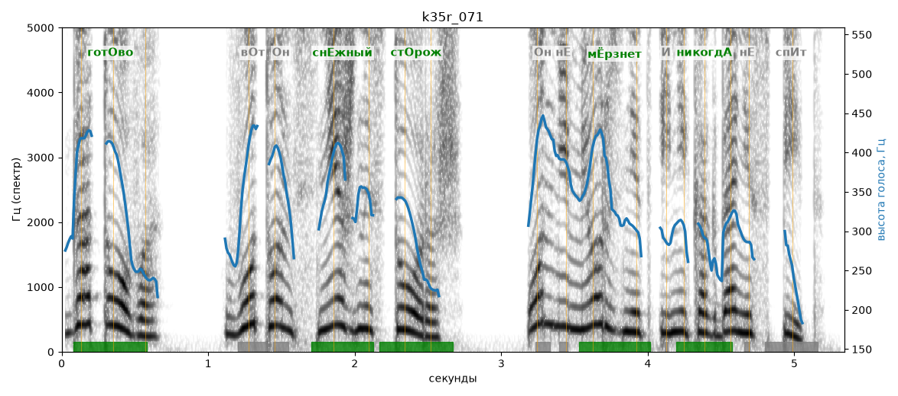

# k35r_071

Голос: **Рон, сборка 35d** · длительность 5.3 с
Эталон: Готово! Вот он, снежный сторож! Он не мёрзнет и никогда не спит!
Распознано: Готово! Вот он снижный сторож. Он не мёрзнет и никогда не спит.
Расхождения в словах: «снежный» → «снижный»

## Ударения
(где нужно: ruaccent)

| слово | нужно | у голоса | |
|---|---|---|---|
| готово | готОво | готОво | ✓ |
| снежный | снЕжный | снЕжный | ✓ |
| сторож | стОрож | стОрож | ✓ |
| мёрзнет | мЁрзнет | мЁрзнет | ✓ |
| никогда | никогдА | никогдА | ✓ |

## Интонация
- ✗ «готово!» — восклицание звучит ровно, без эмоции
- ✗ «вот он снежный сторож!» — восклицание звучит ровно, без эмоции
- ✓ «он не мёрзнет и никогда не спит!» — выделено слово «он» (+5.5 пт)
- Диапазон голоса 10.2 полутонов (живо), средняя высота 321 Гц

## Паузы и темп
- паузы на своих местах
- Темп 5.1 слога/с (нормально)

_Синяя линия — высота голоса. Над словами заглавная буква — где ударение должно быть; красным — голос поставил не туда (уверенно), оранжевым — возможно._
