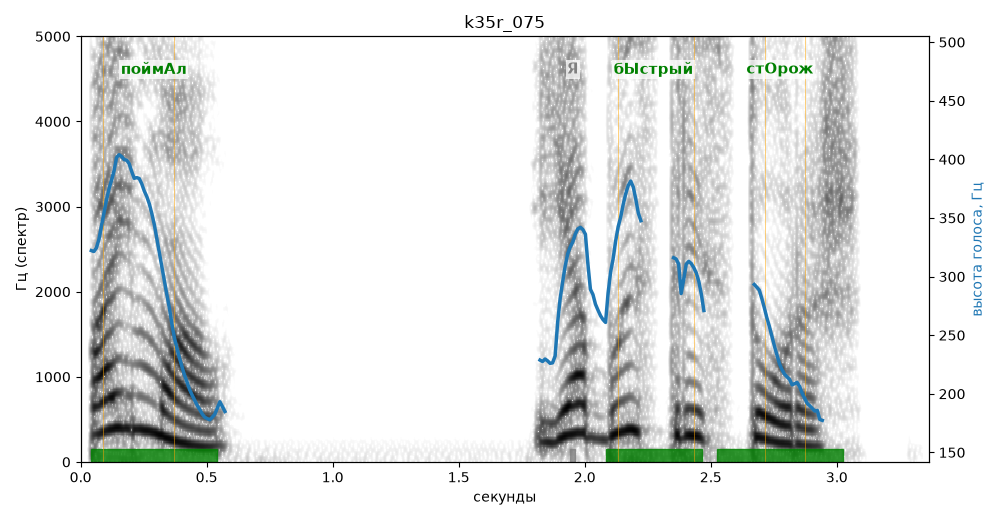

# k35r_075

Голос: **Рон, сборка 35d** · длительность 3.4 с
Эталон: Поймал! Я быстрый сторож!
Распознано: Поймал! Я быстрый сторож.
Слова: все совпали

## Ударения
(где нужно: ruaccent)

| слово | нужно | у голоса | |
|---|---|---|---|
| поймал | поймАл | поймАл | ✓ |
| быстрый | бЫстрый | бЫстрый | ✓ |
| сторож | стОрож | стОрож | ✓ |

## Интонация
- ✓ «я быстрый сторож!» — выделено слово «быстрый» (+2.8 пт)
- Диапазон голоса 13.1 полутонов (живо), средняя высота 287 Гц

## Паузы и темп
- паузы на своих местах
- Темп 3.8 слога/с (медленно)

_Синяя линия — высота голоса. Над словами заглавная буква — где ударение должно быть; красным — голос поставил не туда (уверенно), оранжевым — возможно._
