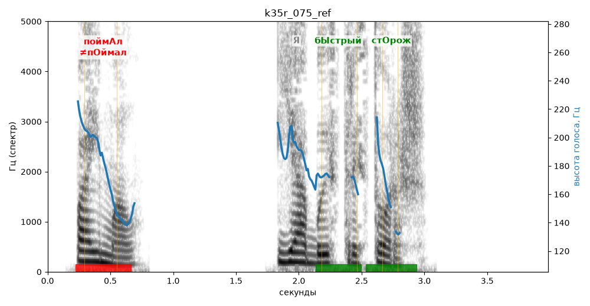

# k35r_075_ref

Голос: **edge:ru-RU-SvetlanaNeural** · длительность 4.0 с
Эталон: Поймал! Я быстрый сторож!
Распознано: поймал. Я быстрый сторож.
Слова: все совпали

## Ударения
(где нужно: ruaccent)

| слово | нужно | у голоса | |
|---|---|---|---|
| поймал | поймАл | пОймал | ✗ ОШИБКА |
| быстрый | бЫстрый | бЫстрый | ✓ |
| сторож | стОрож | стОрож | ✓ |

## Интонация
- ✗ «я быстрый сторож!» — восклицание звучит ровно, без эмоции
- Диапазон голоса 7.1 полутонов (живо), средняя высота 175 Гц

## Паузы и темп
- паузы на своих местах
- Темп 4.3 слога/с (нормально)

_Синяя линия — высота голоса. Над словами заглавная буква — где ударение должно быть; красным — голос поставил не туда (уверенно), оранжевым — возможно._
