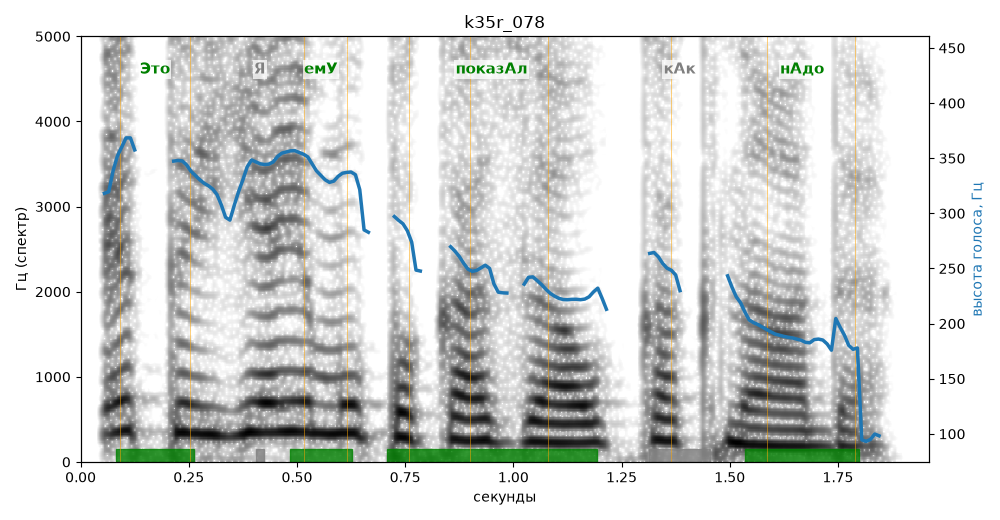

# k35r_078

Голос: **Рон, сборка 35d** · длительность 2.0 с
Эталон: Это я ему показал, как надо.
Распознано: Это я ему показал, как надо.
Слова: все совпали

## Ударения
(где нужно: ruaccent)

| слово | нужно | у голоса | |
|---|---|---|---|
| это | Это | Это | ✓ |
| ему | емУ | емУ | ✓ |
| показал | показАл | показАл | ✓ |
| надо | нАдо | нАдо | ✓ |

## Интонация
- ✓ «это я ему показал как надо.» — конец фразы понижается — звучит законченно
- Диапазон голоса 12.0 полутонов (живо), средняя высота 250 Гц

## Паузы и темп
- паузы на своих местах
- Темп 5.8 слога/с (нормально)

_Синяя линия — высота голоса. Над словами заглавная буква — где ударение должно быть; красным — голос поставил не туда (уверенно), оранжевым — возможно._
