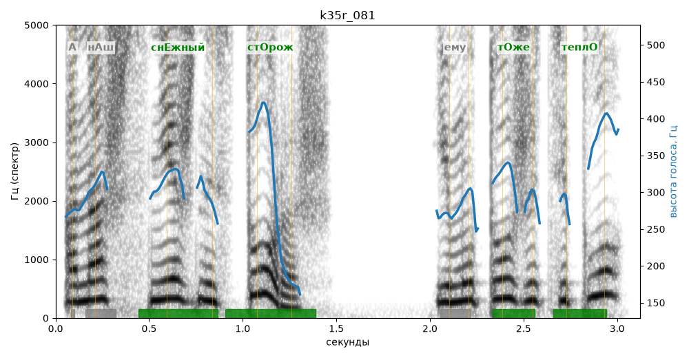

# k35r_081

Голос: **Рон, сборка 35d** · длительность 3.1 с
Эталон: А наш снежный сторож? Ему тоже тепло?
Распознано: А наш снежный сторож, ему тоже тепло.
Слова: все совпали

## Ударения
(где нужно: ruaccent)

| слово | нужно | у голоса | |
|---|---|---|---|
| снежный | снЕжный | снЕжный | ✓ |
| сторож | стОрож | стОрож | ✓ |
| ему | ему | емУ | нет эталона |
| тоже | тОже | тОже | ✓ |
| тепло | теплО | теплО | ✓ |

## Интонация
- ✓ «а наш снежный сторож?» — вопросительный подъём на слове «сторож»
- ✓ «ему тоже тепло?» — вопросительный подъём на слове «тепло»
- Диапазон голоса 13.2 полутонов (живо), средняя высота 301 Гц

## Паузы и темп
- паузы на своих местах
- Темп 5.5 слога/с (нормально)

_Синяя линия — высота голоса. Над словами заглавная буква — где ударение должно быть; красным — голос поставил не туда (уверенно), оранжевым — возможно._
