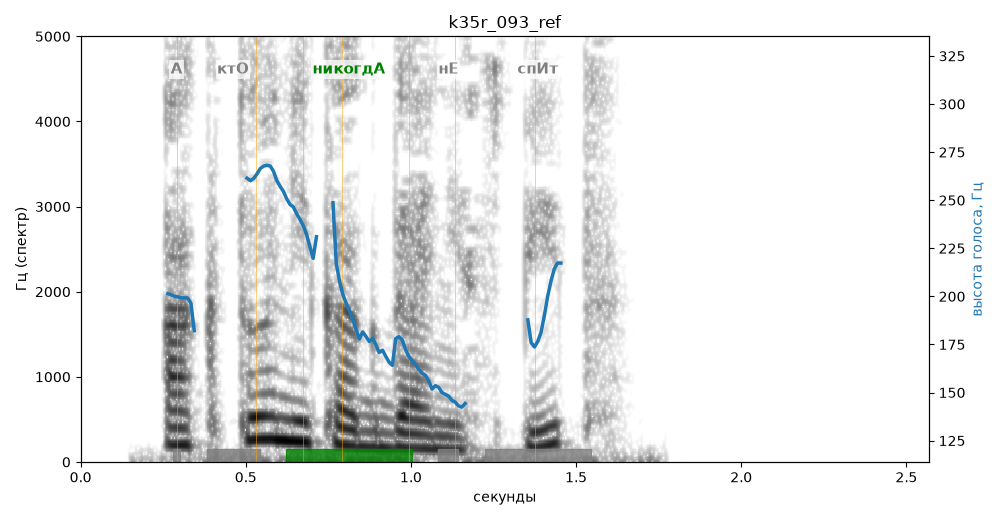

# k35r_093_ref

Голос: **edge:ru-RU-SvetlanaNeural** · длительность 2.6 с
Эталон: А кто никогда не спит?
Распознано: А кто никогда не спит?
Слова: все совпали

## Ударения
(где нужно: ruaccent)

| слово | нужно | у голоса | |
|---|---|---|---|
| никогда | никогдА | никогдА | ✓ |

## Интонация
- ✓ «а кто никогда не спит?» — вопросительный подъём на слове «кто»
- Диапазон голоса 10.3 полутонов (живо), средняя высота 190 Гц

## Паузы и темп
- паузы на своих местах
- Темп 5.5 слога/с (нормально)

_Синяя линия — высота голоса. Над словами заглавная буква — где ударение должно быть; красным — голос поставил не туда (уверенно), оранжевым — возможно._
