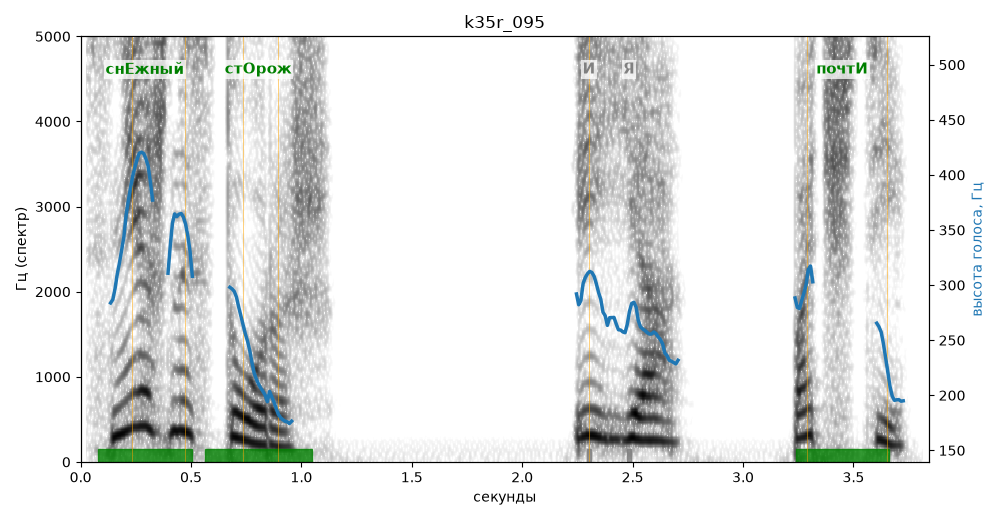

# k35r_095

Голос: **Рон, сборка 35d** · длительность 3.8 с
Эталон: Снежный сторож! И я! Почти.
Распознано: снежный сторож и я почти.
Слова: все совпали

## Ударения
(где нужно: ruaccent)

| слово | нужно | у голоса | |
|---|---|---|---|
| снежный | снЕжный | снЕжный | ✓ |
| сторож | стОрож | стОрож | ✓ |
| почти | почтИ | почтИ | ✓ |

## Интонация
- ✓ «снежный сторож!» — выделено слово «снежный» (+4.4 пт)
- Диапазон голоса 13.5 полутонов (живо), средняя высота 271 Гц

## Паузы и темп
- паузы на своих местах
- Темп 4.9 слога/с (нормально)

_Синяя линия — высота голоса. Над словами заглавная буква — где ударение должно быть; красным — голос поставил не туда (уверенно), оранжевым — возможно._
