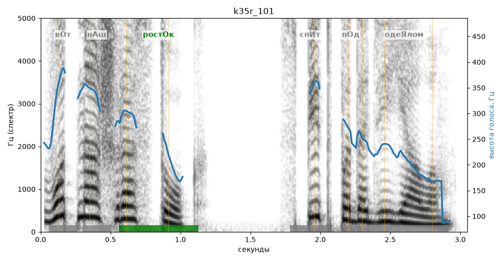

# k35r_101

Голос: **Рон, сборка 35d** · длительность 3.0 с
Эталон: Вот наш росток. Спит под одеялом.
Распознано: Вот наш росток. Спит под одеялом.
Слова: все совпали

## Ударения
(где нужно: ruaccent)

| слово | нужно | у голоса | |
|---|---|---|---|
| росток | ростОк | ростОк | ✓ |
| одеялом | одеЯлом | — | ? |

## Интонация
- ✓ «вот наш росток.» — конец фразы понижается — звучит законченно
- ✓ «спит под одеялом.» — конец фразы понижается — звучит законченно
- Диапазон голоса 13.2 полутонов (живо), средняя высота 240 Гц

## Паузы и темп
- паузы на своих местах
- Темп 4.1 слога/с (нормально)

_Синяя линия — высота голоса. Над словами заглавная буква — где ударение должно быть; красным — голос поставил не туда (уверенно), оранжевым — возможно._
