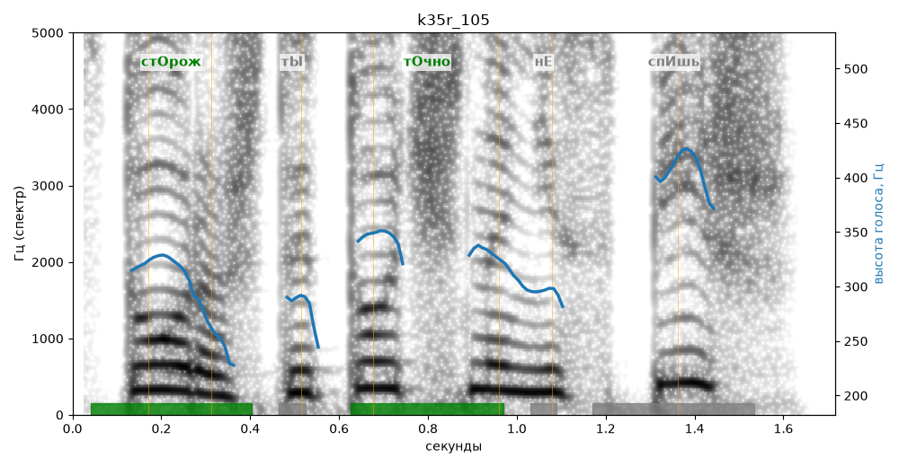

# k35r_105

Голос: **Рон, сборка 35d** · длительность 1.7 с
Эталон: Сторож, ты точно не спишь?
Распознано: Сторож, ты точно не спишь?
Слова: все совпали

## Ударения
(где нужно: ruaccent)

| слово | нужно | у голоса | |
|---|---|---|---|
| сторож | стОрож | стОрож | ✓ |
| точно | тОчно | тОчно | ✓ |

## Интонация
- ✓ «сторож ты точно не спишь?» — вопросительный подъём на слове «спишь»
- Диапазон голоса 8.8 полутонов (живо), средняя высота 321 Гц

## Паузы и темп
- паузы на своих местах
- Темп 4.7 слога/с (нормально)

_Синяя линия — высота голоса. Над словами заглавная буква — где ударение должно быть; красным — голос поставил не туда (уверенно), оранжевым — возможно._
