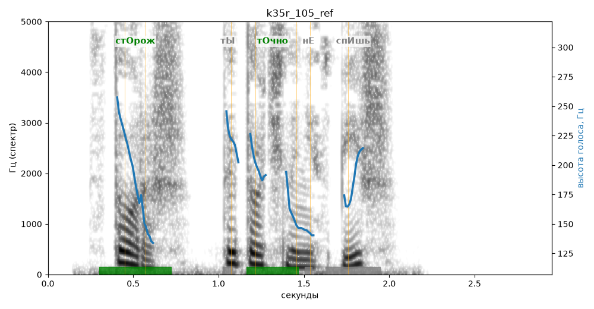

# k35r_105_ref

Голос: **edge:ru-RU-SvetlanaNeural** · длительность 3.0 с
Эталон: Сторож, ты точно не спишь?
Распознано: Сторож, ты точно не спишь?
Слова: все совпали

## Ударения
(где нужно: ruaccent)

| слово | нужно | у голоса | |
|---|---|---|---|
| сторож | стОрож | стОрож | ✓ |
| точно | тОчно | тОчно | ✓ |

## Интонация
- ✗ «сторож ты точно не спишь?» — нет вопросительного подъёма (самое высокое место — «сторож», в начале) — звучит как утверждение
- Диапазон голоса 9.1 полутонов (живо), средняя высота 190 Гц

## Паузы и темп
- паузы на своих местах
- Темп 5.2 слога/с (нормально)

_Синяя линия — высота голоса. Над словами заглавная буква — где ударение должно быть; красным — голос поставил не туда (уверенно), оранжевым — возможно._
